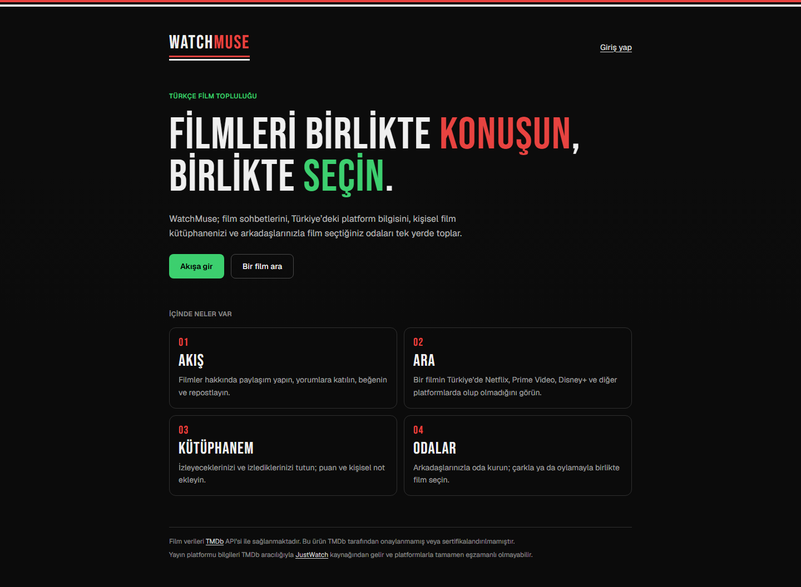
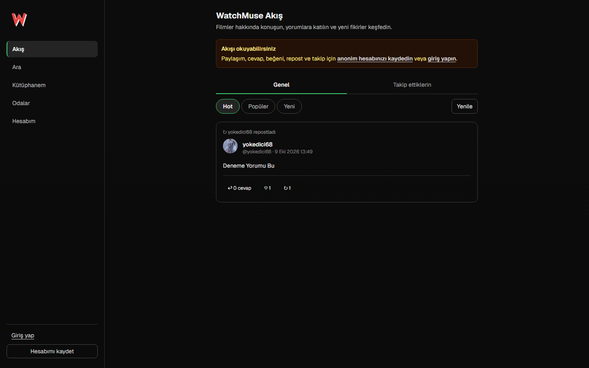
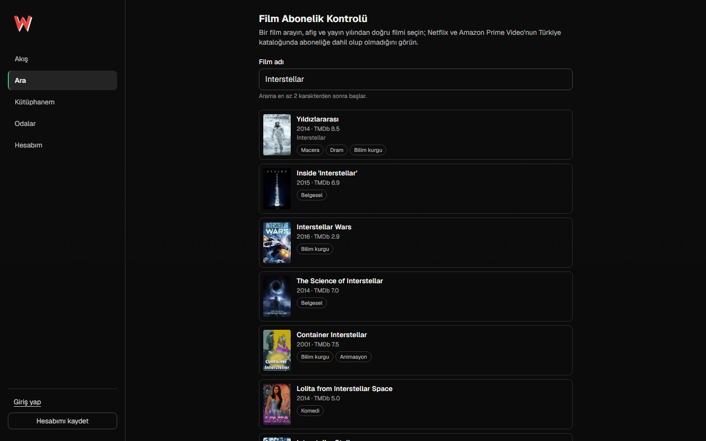
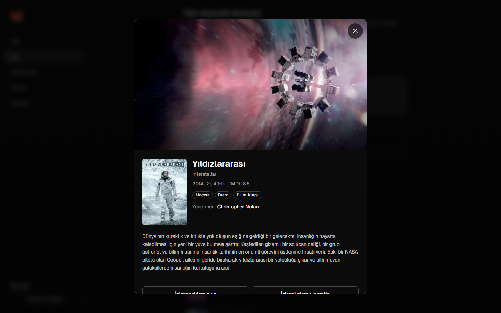
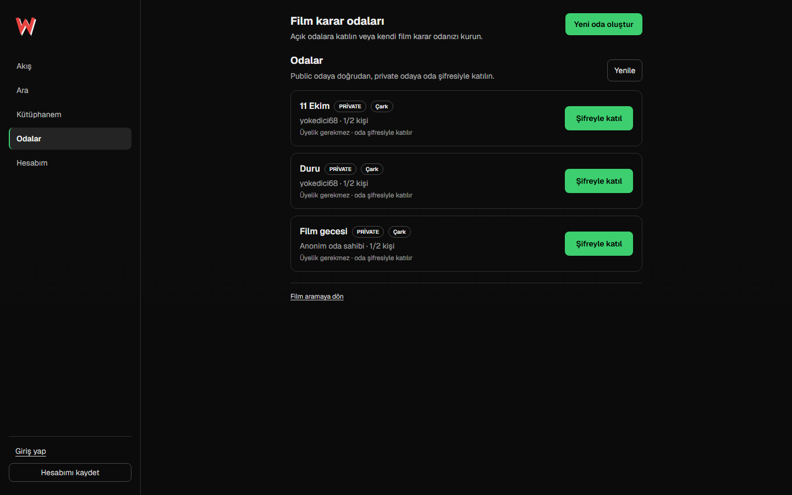
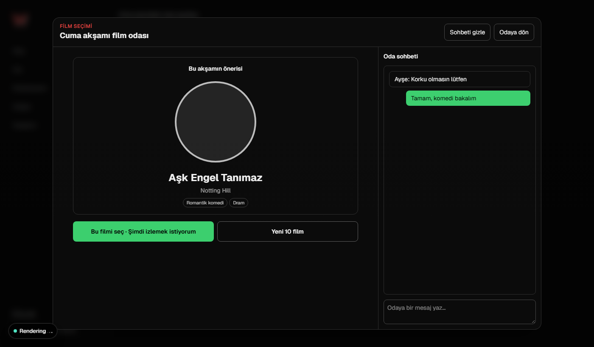
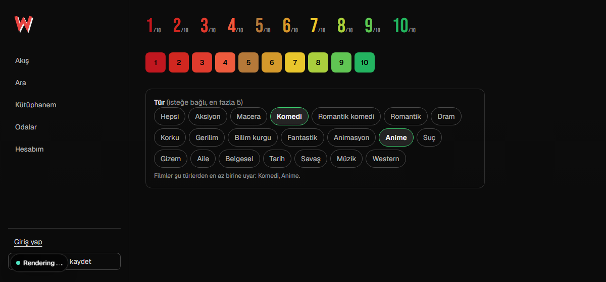
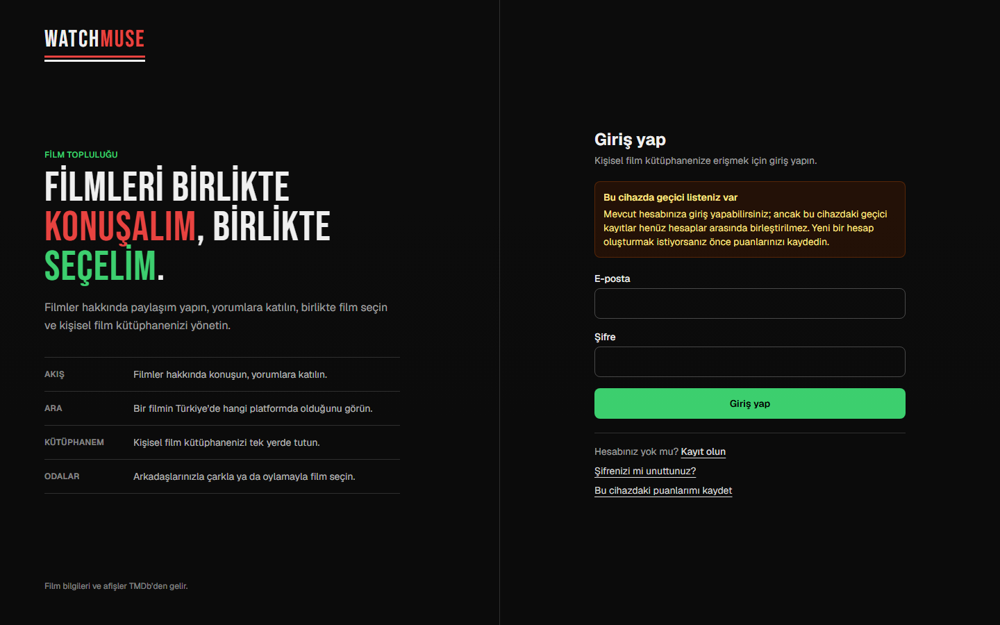
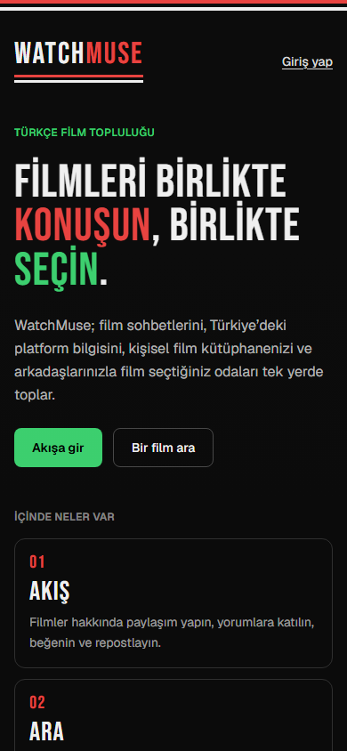
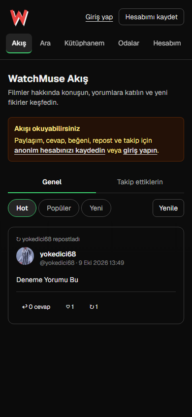

# WatchMuse

**English** · [Türkçe](README.tr.md)

WatchMuse is a Turkish film community built with Next.js and Supabase. It brings
four things together in one app: a social feed about films, film search with
Turkish streaming availability, a personal film library, and rooms where a group
of friends picks a film together through secret votes, a shared wheel and a
personal taste model.

**[Open the live demo → watch-muse-demo-v1.vercel.app](https://watch-muse-demo-v1.vercel.app/)**

The interface is in Turkish; this document is in English.



---

## Contents

- [Screenshots](#screenshots)
- [Features](#features)
  - [Landing page and layout](#landing-page-and-layout)
  - [Social feed](#social-feed)
  - [Follows and profiles](#follows-and-profiles)
  - [Film search and availability](#film-search-and-availability)
  - [Personal library](#personal-library)
  - [Film decision rooms](#film-decision-rooms)
  - [How a round picks films](#how-a-round-picks-films)
  - [Teleparty bridge](#teleparty-bridge)
- [Design system](#design-system)
- [Tech stack](#tech-stack)
- [Architecture](#architecture)
- [Security model](#security-model)
- [Project structure](#project-structure)
- [Local setup](#local-setup)
- [Supabase setup](#supabase-setup)
- [Scripts and tests](#scripts-and-tests)
- [Known limitations](#known-limitations)
- [Attribution](#attribution)

---

## Screenshots

| | |
| --- | --- |
|  |  |
| **Feed** — general and following tabs, Hot / Popular / New sorting | **Search** — TMDb results with Turkish genre labels |
|  |  |
| **Film detail** — backdrop, runtime, genres, director, streaming availability | **Rooms** — public and password-protected rooms |
|  |  |
| **Film selection dialog** — result, actions and room chat *(sample content)* | **Rating colours and genre picker** *(sample content)* |
|  | |
| **Sign in** — brand panel and form, no sidebar | |

<p>
  
  &nbsp;
  
</p>

*On phones the sidebar becomes a top bar with a single scrollable row of sections.*

Screenshots were taken from the live site, except the two marked *sample
content*: those components only appear inside an active room round or a
logged-in library and were rendered with example data.

---

## Features

### Landing page and layout

- Visitors land on a short introduction (`/`) that explains WatchMuse and
  summarises its four sections before sending them on to the feed (`/akis`).
- Every other page uses a **left sidebar**: the logo, the sections (Feed,
  Search, Library, Rooms, My account) with the open one marked in green, and the
  account area with avatar, name and a "edit profile" shortcut.
- The landing and sign-in pages hide the sidebar and use their own full-screen
  layout.
- Signing in lands on `/akis` by default.

### Social feed

- Registered members post about films or anything else; a post can carry a
  film and poster picked through TMDb search.
- One level of replies, likes and reposts. Reposting brings a post back to the
  top of the chronological feed. Authors can delete their own posts; deleting a
  root post removes its replies, likes and reposts.
- Two tabs: **Genel** (everyone) and **Takip ettiklerin** (people you follow,
  their reposts and your own posts).
- Three orderings for each tab:
  - **Hot** — Reddit's ranking: `log10(engagement) + post time / 45000 s`,
    where engagement = likes + 2 × reposts + replies. New posts that get
    attention rise; ten times the engagement is worth about 12.5 hours of
    freshness.
  - **Popüler** — the most engaged posts of the last 30 days.
  - **Yeni** — chronological.
- The chosen tab lives in the URL (`/akis?kapsam=takip&sirala=top`).
- Anonymous visitors can read the feed and replies; posting, replying, liking,
  reposting and following need a saved account. Membership is enforced in
  PostgreSQL, not only in the UI.

### Follows and profiles

- One-way follows, independent of the friendship system.
- Every username has a public profile at `/u/<username>`: cover image, avatar,
  display name, bio, join date, following / follower / post counts, a
  "follows you" badge and a follow button.
- Profile tabs: posts, followers, following, and **likes — visible only to the
  profile owner**.
- **My account** (`/hesabim`) has four tabs: my profile, edit profile (cover,
  avatar, name, username, bio, DM privacy), friends and messages.
  `?sekme=duzenle|arkadaslar|mesajlar` opens a tab directly.
- Friend requests, private messages with unread counts, and DM privacy
  (everyone / friends only / nobody).
- Avatars and covers are JPG, PNG or WebP up to 5 MB, checked by MIME type and
  file signature, stored in Supabase Storage (`profile-avatars`,
  `profile-banners`).

### Film search and availability

- Turkish TMDb search with Turkish and original titles, poster, year, overview
  and rating.
- **Genre labels** on search results and room candidates (Horror, Action,
  Animation, Romance…). Two labels that TMDb does not have are derived:
  Japanese animation becomes **Anime**, romance + comedy becomes
  **Romantik komedi**.
- Availability in Turkey on Netflix, Prime Video, Apple TV+, Disney+, BluTV and
  MUBI, via TMDb's JustWatch data.

### Personal library

- Anonymous visitors can start saving films without an account; the anonymous
  identity is later linked to an email account without moving data.
- **İzlenecekler** (watchlist) and **İzlediklerim** (watched) are separate tabs
  with counts (`/kutuphanem?liste=izlendi`).
- Each film is a one-line row: poster, title, date, note excerpt and rating.
  The editor opens with "Düzenle": status buttons, a 1–10 rating row and a note.
- Search, sorting (recent, rating, title) and 20-at-a-time paging keep long
  lists manageable.
- **Ratings are colour-coded** so likes and dislikes read at a glance: 1–4 red
  (1 darkest), 5 brown, 6 amber, 7 yellow, 8–10 green.

### Film decision rooms

- Rooms hold 2–20 people. Public rooms are created and joined by members;
  private rooms are listed and joined with the host's password (stored as a
  salted `scrypt` hash).
- The host can remove participants, ban them from rejoining and close the room.
  Guests can leave; closing or leaving the page leaves the room.
- **Rooms close automatically after 30 minutes without activity.** Joining,
  messages, rounds, votes, selections, acceptances and Teleparty links count as
  activity; keeping the page open does not. A database trigger tracks the last
  activity, `pg_cron` runs `close_inactive_spaces()` every 5 minutes, and the
  room page and room list also check, so a late job never shows a stale room.
- Room chat with Enter to send and Shift + Enter for a new line.
- Two modes, chosen when the room is created:
  - **Wheel** — a round of 10 candidate films, secret votes, a shared wheel.
  - **Direct** — the host searches TMDb and starts a session with one film.
- When a round or a chosen film is active, the **film selection session opens
  in a full-screen dialog over a blurred page** for everyone. The result offers
  "Bu filmi seç · Şimdi izlemek istiyorum" and "Yeni 10 film", with the room
  chat beside it (collapsed by default on phones). "Odaya dön" minimises it;
  a new round reopens it.

### How a round picks films

1. **Genres (optional).** The host starts the first round with "10 film getir"
   and may first pick up to five genres; "Yeni 10 film" offers the same picker.
   The choice is stored with the round and shown on the voting card.
2. **Platforms.** Candidates come only from platforms the room can watch:
   - first, platforms **everyone** has;
   - if that does not yield enough films, platforms all but one person have,
     then all but two… down to platforms a **majority** has. Earlier steps try
     at most three TMDb pages so starting a round stays fast; the last step
     searches fully. Two-person rooms keep the strict intersection.
   - When platforms were relaxed, the round says which participant lacks which
     platform.
3. **Ranking — personal taste model (`taste-v1`).**
   - Each participant gets a genre affinity from −1 to +1, learned from library
     ratings (1–4 negative, 8–10 positive), the watchlist (slightly positive)
     and past room votes ("İsterim" positive, "İstemiyorum" negative). Genres
     with little evidence are pulled towards zero, so a single rating cannot
     push a genre to an extreme.
   - About 80 candidates are scored for the group by mixing the **average** and
     the **least happy member**: a film one person would dislike drops back.
   - At most three films of the same primary genre near the top, and two of the
     first ten slots are reserved for random exploration, so the model does not
     build a bubble.
   - With no profile data the round uses a seeded random order. Votes and
     ratings are processed only on the server and never shown to anyone. Each
     round records which ranker produced it (`ranker_version`).
4. **Eligibility (database).** Films everyone skipped in the last 30 days and
   films already accepted are never suggested again; at least one candidate per
   round is a new discovery. The database takes the first ten eligible films in
   the server's ranked order.
5. **Voting.** Each participant swipes or taps İstemiyorum / Belki / İsterim on
   the ten films. Votes are secret until everyone is done.
6. **Matching.**
   - Two people: both said **İsterim**.
   - Three or more: a **majority** said İsterim and **nobody** said İstemiyorum.
   - If no film matches, films everyone rated at least **Belki** (nobody
     skipped) match instead, so maybes are offered rather than ending the round.
   - Still nothing: "Yeni 10 film".
7. **Wheel.** The server picks the winner once among the matches; every screen
   spins to the same timestamp and lands on the same film.

### Teleparty bridge

- When everyone accepts the chosen film, a Teleparty step opens. The host opens
  the film on a supported platform, starts a party and copies the link;
  WatchMuse reads it from the clipboard and shows everyone a "join" button.
- Teleparty's extension cannot be driven from a web page, so this step is
  semi-automatic by design.

---

## Design system

- A **retro black theme**: black ground, hairlines instead of shadows, a single
  column of content, and two brand colours — **red** for the brand (the W mark,
  "MUSE", stripes, headline accents) and **green** for actions and selection
  (primary buttons, the open section, selected chips). Status colours (error,
  warning, availability badges) keep their own palette.
- The site always opens dark: `<html class="dark">` with a class-based `dark:`
  variant, so it does not follow the OS setting. Light values remain defined.
- **Logo.** `LogoMark` is a large red W with a white offset shadow, used in the
  sidebar and as the favicon (`src/app/icon.svg`). `Wordmark` sets "WATCHMUSE"
  in Bebas Neue — WATCH white, MUSE red — over red and white stripes, used on
  the landing and sign-in pages ([`src/components/brand/Logo.tsx`](src/components/brand/Logo.tsx)).
- **Colour tokens.** Every colour is a CSS variable in
  [`src/app/globals.css`](src/app/globals.css) (light on `:root`, dark on
  `.dark`) exposed to Tailwind through `@theme inline`, so components use
  `text-ink-60`, `border-line-10`, `bg-fill-inverse`, `text-brand-red` instead
  of `black/white` + `dark:` pairs.

| Group | Example class | Tokens |
| --- | --- | --- |
| Brand | `text-brand-green`, `bg-brand-red` | `brand-green` (#3ccf6e, 9.7:1 on black), `brand-red` (#e8423f, 4.9:1) |
| Page | `bg-wm-background` | `wm-background`, `wm-foreground`, `wm-accent`, `wm-muted` |
| Text | `text-ink-60` | `ink-75` … `ink-40`; hierarchy by opacity, not colour |
| Lines | `border-line-10` | `line-10`, `line-15`, `line-20`, `line-30`, `line-focus`, `line-selected` |
| Fills | `hover:bg-fill-hover` | `fill-subtle`, `fill-hover`, `fill-selected`, `fill-placeholder`, `fill-badge` |
| Primary button | `bg-fill-inverse text-on-inverse` | green with black text in the dark theme |
| Scrim | `bg-scrim` | modal backdrop and controls over images |
| Status | `text-error-ink`, `bg-warning-surface` | `error-*`, `warning-*`, `success-badge*`, `unknown-badge*` |

Typography is Geist for UI text and Bebas Neue (`font-display`) for the logo
and landing headlines. Spacing, radii and type sizes use Tailwind's defaults.

---

## Tech stack

- **Next.js 16** (App Router, Server Components, Route Handlers, Server Actions)
- **React 19**, **TypeScript**
- **Tailwind CSS 4** with CSS-variable design tokens
- **Supabase** — Auth (anonymous + email), PostgreSQL with RLS and
  `SECURITY DEFINER` RPCs, Storage, `pg_cron`
- **TMDb API** (with JustWatch provider data)
- **Vercel** for hosting (production from `main`, a preview for every branch)
- **Vitest** and **ESLint**

---

## Architecture

```text
Browser ──► Next.js Route Handler / Server Action ──► server-only service ──► Supabase RPC ──► PostgreSQL
                 input validation, HTTP mapping          typed parsing           auth + rules + RLS
```

- Route handlers validate input and map errors to HTTP status codes with
  Turkish messages. Authorisation and business rules are re-checked in the
  database, next to the data.
- Clients never touch tables directly: every social and room write goes through
  a `SECURITY DEFINER` function that checks `auth.uid()`, membership and
  anonymity. Reads use RPCs that never return `user_id` or email.
- Polling instead of Realtime for rooms and chat. A single failed poll is
  retried a few times before an error is shown, and a lighter Teleparty poll
  avoids re-downloading a finished round's ten candidates.
- The server owns everything that must be fair: candidate pools, rankings, the
  wheel winner and timestamps.

---

## Security model

| Rule | How |
| --- | --- |
| TMDb token never reaches the browser | The TMDb client runs in `server-only` modules |
| Service-role key never reaches the browser | Used only in trusted server operations |
| Private room passwords are not stored in clear | Random salt + `scrypt` hash in a table closed to clients |
| Invitation tokens are not stored in clear | Only a SHA-256 hash is stored |
| Room writes never hit tables directly | Permission, capacity and role checks in `SECURITY DEFINER` RPCs |
| Social writes require membership | PostgreSQL checks `auth.users.is_anonymous` on every write |
| The feed and profiles leak no identity | Read RPCs return usernames, never `user_id` or email; anonymous accounts have no profile |
| Likes are private | `list_profile_posts` returns likes only to the profile owner |
| Following is members-only | `toggle_follow` checks membership and refuses self-follows |
| DM privacy cannot be bypassed | The recipient's preference and friendship are rechecked in the RPC |
| Uploads are restricted | Size, MIME type and file signature are verified; paths are tied to the user |
| Likes and reposts are unique | `primary key (post_id, user_id)` |
| The library belongs to its owner | RLS limits rows to `auth.uid()` |
| Secret votes stay secret | Clients see only their own votes and the shared result |
| Taste data stays on the server | Ratings and votes are read with the service role only to rank candidates |
| The wheel result is shared and fixed | Picked once on the server and stored with a timestamp |
| Internal errors do not leak | Raw SQL and internal messages become fixed domain errors |

`NEXT_PUBLIC_SUPABASE_ANON_KEY` is a publishable key and grants nothing on its
own; permissions come from RLS and the secure RPCs. `.env.local` is ignored by
Git.

---

## Project structure

```text
src/
├── app/
│   ├── page.tsx               landing page
│   ├── akis/                  social feed
│   ├── ara/                   film search
│   ├── kutuphanem/            personal library
│   ├── rooms/                 room list, creation and room page
│   ├── u/[username]/          public profile
│   ├── hesabim/               my account
│   ├── giris/ kayit/ …        auth pages
│   ├── api/feed/              feed, replies, likes, reposts
│   ├── api/profiles/          profile, posts/likes, follow, followers
│   ├── api/movies/            TMDb search, details, providers
│   ├── api/rooms/             rooms, chat, rounds, selection, Teleparty
│   ├── api/account/           profile, avatar, cover, people, messages
│   ├── globals.css            colour tokens and global styles
│   └── icon.svg               favicon
├── components/
│   ├── brand/                 logo
│   ├── social/                feed, post list, composer
│   ├── profile/               profile view and follower lists
│   ├── rooms/                 room page, round, session dialog, chat, genre picker
│   ├── library/               library list and rows
│   ├── account/               account centre
│   └── SiteSidebar.tsx        left sidebar
└── lib/
    ├── social/                feed and profile services, validation, types
    ├── rooms/                 room services, candidate pipeline, taste model, policies
    ├── library/               library service, rating colours
    ├── tmdb/                  TMDb client, normalisation, genres
    ├── account/               account service, image uploads
    ├── auth/                  verified user access
    └── supabase/              browser, server and admin clients

supabase/migrations/           ordered PostgreSQL migrations
supabase/tests/                integration test harness for a real database
docs/screenshots/              images used in this README
```

---

## Local setup

Requirements:

- A current Node.js LTS
- A TMDb Read Access Token
- A Supabase project for the feed, accounts, library and rooms

```bash
npm install
cp .env.example .env.local      # PowerShell: Copy-Item .env.example .env.local
```

`.env.local`:

```dotenv
TMDB_ACCESS_TOKEN=your_tmdb_read_access_token_here
NEXT_PUBLIC_SUPABASE_URL=https://your-project-ref.supabase.co
NEXT_PUBLIC_SUPABASE_ANON_KEY=your_supabase_anon_or_publishable_key
SUPABASE_SERVICE_ROLE_KEY=your_supabase_service_role_key
NEXT_PUBLIC_SITE_URL=http://localhost:3000
```

```bash
npm run dev
```

The app runs at [http://localhost:3000](http://localhost:3000).

To try only the search screen without a TMDb key, set
`TMDB_ACCESS_TOKEN=DEMO`; it serves deterministic sample data. The feed,
accounts, library and rooms still need Supabase.

---

## Supabase setup

1. Create a Supabase project.
2. Enable **Authentication → Providers → Anonymous sign-ins**.
3. Configure the Email provider, Manual Linking and the redirect URLs
   (**Authentication → URL Configuration**: set the Site URL to your
   deployment and add `<your-site>/**` to Redirect URLs, otherwise email links
   point to `localhost`).
4. Apply every file in `supabase/migrations/` in filename order, either with the
   CLI:

   ```bash
   supabase link --project-ref <project-ref>
   supabase db push
   ```

   or by pasting each file into the **SQL Editor** and running it.

   Recent migrations worth knowing about:

   | Migration | What it adds |
   | --- | --- |
   | `20261008000100_follows_feed_sorting_and_profiles` | follows, Hot / Popular / New feed, profiles, cover images |
   | `20261009000100_room_inactivity_and_movie_genres` | last-activity triggers, 30-minute auto-close, `pg_cron` job, genre cache |
   | `20261010000100_taste_ranking_and_round_genres` | genre choice per round; the round RPC follows the server's ranking |
   | `20261010000200_majority_room_matching` | majority matching for 3+ people and the "Belki" fallback |

   The auto-close migration enables `pg_cron`. If the extension cannot be
   enabled, the migration still succeeds and rooms are closed whenever a room or
   the room list is opened.
   The matching migration patches existing functions in place: it reads each
   current definition and replaces only the matching condition, so earlier
   patches are kept. It stops with an error if the expected text is missing.
5. Set the environment variables above locally and in Vercel.

`SUPABASE_SERVICE_ROLE_KEY` must only be used on the server: never prefix it
with `NEXT_PUBLIC_` and never commit it.

More detail: [AUTH_AND_LIBRARY_SETUP.md](AUTH_AND_LIBRARY_SETUP.md) and
[ROOM_SELECTION_AND_WHEEL_SETUP.md](ROOM_SELECTION_AND_WHEEL_SETUP.md).

---

## Scripts and tests

```bash
npm run dev         # development server
npm run lint        # ESLint
npm run typecheck   # TypeScript
npm test            # Vitest
npm run build       # production build
```

The Vitest suite covers validation, the candidate pipeline, the taste model,
platform tiers, genre labels, polling policies and error mapping. Migration
contract tests read the SQL files and check their security rules — for example
that list functions never return `user_id`, that tables stay closed to client
roles, and that SQL patch patterns match the real function bodies exactly once.

These are static checks. Behaviour that only a database can prove — constraint
semantics, transactions, lock races, RLS and grants — is covered by the
integration harness in [`supabase/tests/`](supabase/tests/README.md), which runs
against a disposable PostgreSQL / Supabase database.

---

## Known limitations

- Replies are one level deep.
- The feed and profile lists show the first 30 items, replies and follower lists
  the first 50; there is no infinite scroll.
- Hot and Popular are computed at query time; a much larger feed would need a
  precomputed score column.
- The taste model learns genres only; more signals (cast, keywords, embeddings)
  and collaborative filtering are possible next steps once there is more data.
- No blocking, reporting or moderation panel yet.
- DMs have no attachments, deletion or end-to-end encryption.
- Rooms and chat use polling rather than Supabase Realtime.
- Teleparty setup is semi-automatic because of the browser extension.
- TMDb search returns the first result page only.
- The provider row's brand-coloured left border is hidden in the dark theme by
  a later border colour; it was kept as is to avoid a visual change.
- The local room store (`USE_LOCAL_ROOMS`) is for development only and is lost
  when the process restarts.

---

## Attribution

This product uses the TMDb API but is not endorsed or certified by TMDb.
Streaming availability comes from JustWatch via TMDb and may not be perfectly in
sync with the platforms' catalogues.

